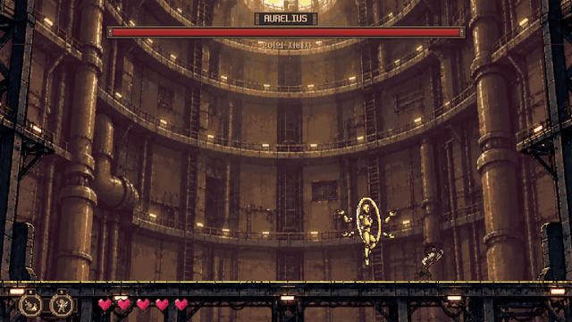

# SteamHeart

고철을 모아 제작대에서 강화하고, 보스 둘을 쓰러뜨리며 도시의 하층에서 상층으로 올라가는 2D 사이드뷰 액션 어드벤처입니다.

- 영상과 구현 설명: https://juni4268.github.io/steamheart/
- 플레이 빌드 (Windows): [Releases](https://github.com/juni4268/SteamHeart-Portfolio/releases/latest)

## 개요

| | |
|---|---|
| 엔진 | Unity 6 (6000.3.11f1) · C# |
| 시점 | 2D 사이드뷰 |
| 기간 | 2026년 8월~11월 (4개월) |
| 인원 | 5인 팀 '석복동' |
| 담당 | 게임 프로그래밍 전체, UI 제작, 레벨 구현·연출 적용 |

## 구현 내용

소개 페이지에서 영상과 함께 설명하는 부분입니다.

**최종 보스의 부위별 공격 패턴**
최종 보스는 손 네 개와 링을 따로 움직입니다. 주요 패턴은 시작하기 전에 필요한 부위를 예약하고, 예약되지 않은 손은 계속 빔을 쏩니다. 체력이 절반 아래로 내려가면 2페이즈가 됩니다.
→ [`Boss2PartUsage.cs`](Assets/Scripts/Boss/Boss2/Core/Boss2PartUsage.cs), [`Boss2PatternRunner.cs`](Assets/Scripts/Boss/Boss2/Core/Boss2PatternRunner.cs)

**중간 보스의 공격 패턴과 잔해 연계**
중간 보스는 양손으로 네 가지 패턴을 씁니다. 내려찍기가 바닥에 잔해를 남기고, 과부하는 그 잔해를 쳐서 벽까지 날립니다. 잔해가 사라지면 다음 공격으로 내려찍기를 예약해 다시 채웁니다.
→ [`Boss1PatternSelector.cs`](Assets/Scripts/Boss/Boss1/Core/Boss1PatternSelector.cs), [`Boss1DebrisField.cs`](Assets/Scripts/Boss/Boss1/Patterns/Debris/Boss1DebrisField.cs)

**사망 후에도 이어지는 성장**
죽으면 처리장 입구에서 최대 체력으로 다시 시작합니다. 모아 둔 고철과 강화는 그대로 남고, 파일로 저장해서 게임을 껐다 켜도 유지됩니다.
→ [`PlayerRuntimeState.cs`](Assets/Scripts/Player/Progress/PlayerRuntimeState.cs), [`PlayerPermanentProgress.cs`](Assets/Scripts/Player/Progress/PlayerPermanentProgress.cs), [`PlayerRespawnController.cs`](Assets/Scripts/Player/PlayerRespawnController.cs)

## 조작

| 동작 | 키보드 | 게임패드 |
|---|---|---|
| 이동 | ← → | 왼쪽 스틱 / 방향 패드 |
| 점프 | C | A |
| 기본 공격 | Z | X |
| 대시 | X | B |
| 강타 | A | RB |
| 카운터 | S | LB |
| 상호작용 | F | Y |
| 포털 이용 | ↑ | 위 |
| 아래로 내려가기 | ↓ | 아래 |

키는 게임 안 설정 화면에서 바꿀 수 있습니다.

## 그 외 코드

보스, 플레이어, 적, 월드, 테스트

| 내용 | 위치 |
|---|---|
| 최종 보스의 주요 패턴 선택과 간격 | [`Boss2MainPatternScheduler.cs`](Assets/Scripts/Boss/Boss2/Core/Boss2MainPatternScheduler.cs) |
| 최종 보스의 패턴 여섯 가지 | [`Assets/Scripts/Boss/Boss2/Patterns`](Assets/Scripts/Boss/Boss2/Patterns) |
| 중간 보스의 패턴 순서와 잔해 재공급 | [`Boss1PatternScheduler.cs`](Assets/Scripts/Boss/Boss1/Core/Boss1PatternScheduler.cs) |
| 중간 보스의 패턴 네 가지 | [`Assets/Scripts/Boss/Boss1/Patterns`](Assets/Scripts/Boss/Boss1/Patterns) |
| 플레이어 공격(지상 2타, 공중 공격, 강타, 카운터) | [`Assets/Scripts/Player/Combat`](Assets/Scripts/Player/Combat) |
| 제작대 강화 수치 | [`UpgradeSettings.cs`](Assets/Scripts/Player/Progress/UpgradeSettings.cs) |
| 일반 적 | [`Assets/Scripts/Enemy`](Assets/Scripts/Enemy) |
| 함정, 포털, 컷신, 씬 전환 | [`Assets/Scripts/World`](Assets/Scripts/World) |
| 에디터 테스트 | [`Assets/Editor/Tests`](Assets/Editor/Tests) |

## 팀

| 이름 | 역할 |
|---|---|
| 최준이 | 프로그래밍, 애니메이션·연출 적용, 맵 구성·레벨 구현, UI 제작·구현 |
| 전진범 | 총괄, 기획, 배경 디자인, 레벨 그래픽 디자인 |
| 남궁석 | 캐릭터·보스 디자인, 무기·이펙트 디자인, 사운드 디렉팅 |
| 임경섭 | 기획, 사운드 디자인 |
| 최지환 | 스토리보드, 편집 |

## 이 저장소에 대해

포트폴리오용으로 **코드만** 공개합니다. 그래픽, 사운드, 씬, 프리팹은 팀원들의 작업물이라 포함하지 않았고, 이 저장소만으로는 Unity에서 게임을 실행할 수 없습니다.

- `Assets/Scripts` — 게임 코드 (Boss, Player, Enemy, Combat, Weapon, World, UI, Camera)
- `Assets/Editor` — 에디터 도구와 테스트
- `Packages/manifest.json`, `ProjectSettings/ProjectVersion.txt` — 사용 패키지와 Unity 버전
